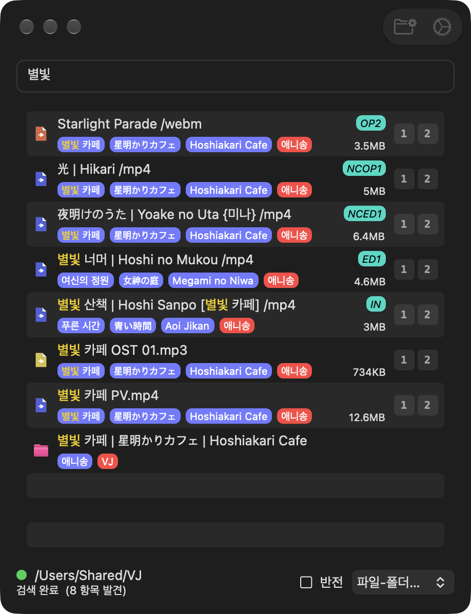

# FastFind

### 빠르게 정확한 파일 검색.
#### Search Faster, Accurately. Written in Rust

<p align="center"></p>

[다운로드](https://github.com/ImBada/FastFind/releases/latest/download/FastFindLatest.dmg)

최소 사양: macOS 26 이상, Apple Silicon

[SearchEverything](https://github.com/ImBada/SearchEverythingForMac)을 Rust로 새로 만든 후속 앱입니다. 기능은 그대로
가져오고, 더 빠르고 매끄럽게 다듬었습니다.

### 특징

- 타이핑 시 실시간으로 탐색 (수만 개 파일도 수 밀리초)
- 순수한 파일 탐색에 특화된 검색 기능 (정확한 파일명 기준 혹은 폴더명 기준 검색)
- 네이밍 규칙을 따른 파일의 시각화 (종류 배지, 폴더 태그)
- 다양한 정렬 옵션
- Quick Look (훑어보기) 지원 (파일 선택 후 스페이스 바, 이후 방향키나 마우스 등으로 선택 전환 가능)
- 검색 결과를 기준으로 파일명을 일괄 수정 (바뀔 목록을 미리 보고 골라서 적용)
- 파일 삭제, 폴더에 드래그 시 복사/이동 등 Finder와 비슷하게 작동하는 UX
- VJDeck으로 바로 보내기
- macOS 기본 컨트롤로 만들어 다크 모드, 스크롤 막대 보기 등 시스템 설정을 그대로 따름
- 새 버전이 나오면 업데이트할지 물어보고, 수락하면 바로 업데이트

### 개요

폴더 기준 검색, 정확한 파일명 검색, 메모리에 인덱싱하여 엄청 빠른 검색, 네이밍 규칙을 따른 파일의 시각화, 다양한 정렬,
네이티브 Quick Look (훑어보기) 지원 등의 기능이 구현돼 있습니다. 즉석으로 영상을 계속 찾아야 하는 라이브 VJ 용도를
중심으로 개발했습니다.

경로를 고르면 그 안의 파일을 메모리에 인덱싱하고, 인덱싱된 데이터를 기반으로 검색합니다. 인덱싱이 완료되면 하단의
경로명 앞에 초록색 원이 보입니다.

- 인덱싱 시점 이후 앱 밖(Finder 등)에서 생긴 파일/폴더의 변동사항은 검색되지 않습니다. 같은 경로를 다시 선택하면
  재인덱싱합니다. FastFind 안에서 한 이름 변경·이동·삭제는 바로 반영됩니다.
- 숨김 파일, `.`으로 시작하는 이름, `.noindex`로 끝나는 폴더는 인덱싱하지 않고, 심볼릭 링크는 따라 들어가지 않습니다.
- 한글 자모가 조합형(NFD)으로 저장된 이름도 같은 글자로 찾습니다.

### 주의할 점

- 공증받지 않은 앱이라 처음 열 때는 우클릭 → 열기로 실행해 주세요.
- 탐색 경로 안에 파일이 많은 경우 인덱싱이 더 오래 걸립니다.
- 경로 내에 클라우드 저장소나 FTP와 같은 원격 저장소 등이 있을 경우 문제가 발생할 수 있습니다. 로컬로만 이루어진 환경에서
  사용하는 것을 권장드립니다.
- 폴더를 읽을 권한이 없으면 하단 상태 줄에 알려 줍니다. 시스템 설정에서 권한을 준 뒤 다시 인덱싱해 주세요.
- 폴더 접근에 문제가 생기거나 검색에 오류가 발생하면 개발자에게 알려주세요.

### 사용법

1. 프로그램을 연 후 툴바의 폴더 버튼(경로 선택)을 눌러 파일을 검색할 경로를 선택합니다. 인덱싱이 시작됩니다.
2. 검색합니다.

### 조작법

- 키보드 상/하로 선택된 파일을 이동할 수 있습니다. Shift와 함께 누르면 범위를 넓힙니다.
- ⌘ + 클릭, Shift + 클릭으로 여러 개를 선택하고, ⌘A로 전체 선택합니다.
- ⌘C를 누르면 경로를 제외한 파일명이 복사됩니다.
- Return이나 더블클릭으로 파일을 엽니다.
- 파일을 선택한 후 **스페이스 바**를 누르면 Quick Look (훑어보기) 창이 나타납니다. 이 상태로 방향키, 마우스로 선택된
  파일을 전환하면 미리보기도 따라 바뀝니다.
- 드래그 앤 드랍: 검색 결과를 Finder 등으로 끌어낼 수 있고, 파일을 검색 결과의 폴더에 놓으면 그 폴더로 이동합니다
  (다른 디스크면 복사). 같은 이름이 있으면 덮어쓸지 묻고, 덮어쓴 기존 파일은 휴지통으로 갑니다.
- 우클릭 메뉴에 열기, 정보 가져오기, Finder에서 보기, 전체 경로 복사, 파일 이름만 복사, VJDeck으로 보내기, 일괄 이름 변경,
  이름 변경, 휴지통으로 이동이 있습니다.
- 중복되는 단어의 경우 큰따옴표로 묶으면 해당 키워드가 고정됩니다. 예) `"fure fure"` (Fure Fure Mirai라는 파일을 검색하는 경우)
- 하단에서 정렬(가나다순, 파일-폴더순, 크기순, 경로순 등)과 반전을 고릅니다.

### 옵션

툴바의 톱니바퀴를 누르면 나옵니다.

- **찾은 폴더 내 모든 파일 표시**: 폴더에 일치하는 이름이 있으면 그 폴더 안의 모든 파일을 결과에 포함합니다. 파일명에도
  매치가 있는 경우 결과에 포함됩니다.
  - **깊은 폴더 검색**: 한 단계 위 폴더 이름까지 일치를 봅니다.
- **경로 정보 비표시**: 파일의 이름 아래에 폴더명이 태그처럼 표시됩니다. 폴더명에 `|`가 있는 경우 해당 문자를 기준으로
  태그가 분리되고, 한 단계 위 폴더는 빨간 태그로 표시됩니다. 이것이 보기 불편한 경우 본 옵션을 체크하시면 파일명만
  나옵니다.
- **원본 파일명**: 네이밍 규칙에 따라 정리된 표시 대신 실제 파일명을 보여 주고, 그 자리에서 바로 이름을 바꿀 수 있습니다.
- **일본어 전각→반각문자 변환 검색**: 전각 영숫자·기호(`ＡＢＣ１２３`)를 반각으로 맞춰서, 어느 쪽으로 입력해도 찾습니다.
- **Import to VJDeck**: 파일마다 덱 번호 버튼(Deck numbers에 적은 번호, 1~4)이 붙고, 누르면 VJDeck의 그 덱으로 파일을
  불러옵니다.

### 네이밍 규칙

- 애니송 VJ를 위해 직접 정한 macOS에서 사용하는 네이밍 규칙이 있습니다.
  - `곡명 {아티스트명} (종류OP/ED) [작품명].확장자`
    - 곡명의 경우 일본어라면 `|`로 구분한 후 영어 발음을 그대로 뒤에 표기 ex) `光 | Hikari`
    - 아티스트명의 경우 생략 가능 (생략 시 `{}`까지 완전히 지울 것)
    - 종류는 일반 크레딧의 경우 OP1/ED1과 같이 표기. 논크레딧의 경우 NCOP1/NCED1과 같이 표기. 버전이 다를 경우
      NCOPv1과 같이 표기. 특정 에피소드에만 나오는 노래의 경우 버전 넘버링보단 NCED EP7과 같은 방식을 선호함.
    - 작품명은 기본적으로 폴더의 가장 첫 구분 이름(`|`로 나눈 경우)을 그대로 넣음. 폴더에 관해선 아래 설명 참고.
    - 폴더명은 한국어 공식, 한국어 비공식(고전 애니의 경우), 일본어, 영어 순서로 `|`로 나누어 폴더명에 한 번에 넣음.
      ex) `이것은 좀비입니까? | これはゾンビですか? | Kore wa Zombie Desuka?`
  - 위의 규칙을 따르는 파일은 종류가 오른쪽에 배지로 표시됩니다. 작품명이 폴더 이름과 같으면 생략하고, 다르면
    `[작품명]`으로 보여 줍니다.
- 원하시는 규칙이 있으면 추가 문의를 보내주세요.

### 업데이트

새 버전이 나오면 받아서 확인해 둔 뒤 "업데이트하시겠습니까?"라고 묻습니다. **업데이트**를 누르면 새 버전으로 바꾸고 다시
시작하고, **나중에**를 누르면 다음에 앱을 열 때 다시 묻습니다. 업데이트 뒤 macOS가 폴더 접근 권한을 다시 물을 수 있습니다.
새 버전 확인을 끄려면 터미널에서:

```sh
defaults write BadaGames.FastFind autoUpdate -bool NO
```

제보 페이지 [github.com/ImBada/FastFind/issues](https://github.com/ImBada/FastFind/issues)

### 크레딧

개발 임바다 [x.com/BD_MARU](https://x.com/BD_MARU)

### 개발

- 빌드, 테스트, 릴리스: [DEVELOPMENT.md](DEVELOPMENT.md)
- SearchEverything(Swift)에서 옮긴 기록과 달라진 점: [MIGRATION.md](MIGRATION.md)

MIT 라이선스 — [LICENSE](LICENSE)
